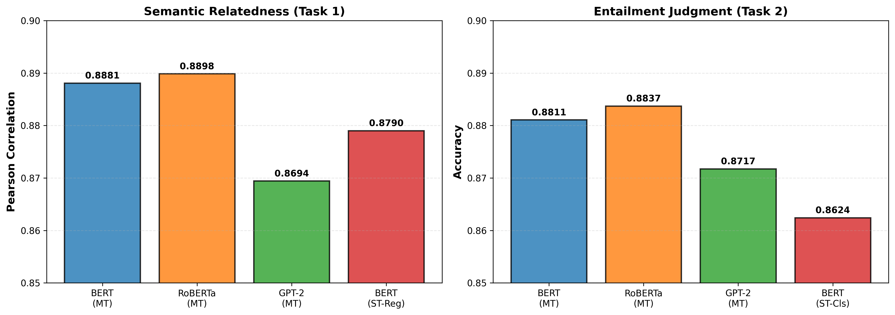

# Assignment 3 Report: Multi-output Learning

Note: For ease of grading, data is presented in textual form rather than as images.

## Question 1: RoBERTa-base Model Training (10%)

### Test Performance Results

| Model | Task 1 (Pearson) | Task 2 (Accuracy) | Combined Score |
|-------|------------------|-------------------|----------------|
| BERT-base | 0.8881 | 0.8811 | 1.7691 |
| RoBERTa-base | 0.8898 | 0.8837 | 1.7735 |

RoBERTa marginally outperforms BERT (+0.0044 combined score, ~0.26% improvement).

### Why RoBERTa Performs Better

1. More Training Data: 10x larger dataset (160GB vs 16GB) → richer semantic representations.

2. Dynamic Masking: Different masks per epoch vs static preprocessing → more robust feature learning.

3. Removed NSP: Focuses solely on MLM, avoiding superficial next-sentence signals and allowing deeper linguistic pattern capture.

4. Larger Batch Size: 8K vs 256 → more stable and effective optimization.

While performance gap is small (0.44% combined), it is consistent across both tasks. Classification benefits more (+0.26%) than regression (+0.17%), indicating RoBERTa's improvements particularly aid decision boundary learning.

## Question 2: GPT-2 Model Training (10%)

### Test Performance Results

| Model | Pearson (Task 1) | Accuracy (Task 2) | Combined Score |
|-------|------------------|-------------------|----------------|
| BERT | 0.8881 | 0.8811 | 1.7691 |
| RoBERTa | 0.8898 | 0.8837 | 1.7735 |
| GPT-2 | 0.8694 | 0.8717 | 1.7411 |

### Why BERT/RoBERTa Outperform GPT-2

1. Bidirectional context vs causal: BERT/RoBERTa attend to all tokens; GPT-2 only looks backward → richer understanding of sentence pairs.

2. Task-aligned pre-training: BERT's MLM + NSP align with sentence pair classification; GPT-2's next-token prediction is generation-focused.

3. Explicit segment markers: BERT's token_type_ids distinguish premise/hypothesis; GPT-2 concatenates without structure.

Performance gap: GPT-2 ~1.6–2.3% lower across both tasks, confirming bidirectional encoders suit discriminative tasks.

## Question 3: Multi-Output vs. Single-Task Learning (5%)

| Model | Task | Metric | Test Score |
|-------|------|--------|-----------|
| Multi-task BERT | Task 1 (Regression) | Pearson Correlation | 0.8881 |
| Single-task BERT | Task 1 (Regression) | Pearson Correlation | 0.8790 |
| | | Improvement | +0.0091 (+1.04%) |
| Multi-task BERT | Task 2 (Classification) | Accuracy | 0.8811 |
| Single-task BERT | Task 2 (Classification) | Accuracy | 0.8624 |
| | | Improvement | +0.0187 (+2.17%) |

### Analysis

Does Multi-Output Learning Improve Performance? YES - Multi-task learning consistently improves performance on both tasks.

1. Shared Representation Benefits: Both tasks (semantic relatedness + entailment) are complementary. Task 1 provides similarity signals; Task 2 provides logical relationship signals. Shared encoder learns richer features benefiting both.

2. Classification Benefits More (+2.17% vs +1.04%): Binary classification is more sensitive to representation quality. Regression's continuous scores provide additional supervision signal that helps learning decision boundaries.

3. Task Complementarity: Both tasks improve simultaneously (no trade-off), confirming they compete for capacity rather than complement. Entailment implicitly depends on relatedness: high similarity → entailment/contradiction; low similarity → no entailment.

4. Regularization Effect: Multi-task learning prevents overfitting by forcing the encoder to satisfy multiple objectives, improving generalization.

Conclusion: Multi-task learning achieves 1–2% improvement through complementary task signals and regularization, outperforming single-task specialists.

## Question 4: Error Analysis and Performance Improvement (10%)

### Error Distribution (Test set, 4,928 samples)

| Error Category | Count | Percentage | Confidence Range |
|---|---|---|---|
| High Confidence Errors | 542 | 92.5% | > 0.70 |
| Borderline Errors | 38 | 6.5% | 0.55 - 0.70 |
| Low Confidence Errors | 6 | 1.0% | < 0.55 |
| Total Errors | 586 | 11.9% | - |
| Overall Correct | 4,342 | 88.11% | - |

### Key Findings

92.5% of errors are high-confidence—model overconfidently predicts wrong labels. This reveals systematic misclassifications tied to:

1. Lexical vs Semantic Mismatch: Model relies on surface word overlap; fails on paraphrased pairs ("car" vs "automobile").

2. Negation & Compositional Structures: Cannot properly scope negation ("didn't win" vs "won") or track complex clause relationships.

3. Domain-Specific Terminology: Limited exposure to image/object recognition domain despite pre-training.

Rare low-confidence errors (1%) suggest good calibration on easy cases; borderline errors (6.5%) reflect genuinely ambiguous samples.

### Performance Improvement Strategies

Priority improvements (no pushing to +X% estimates):

1. Focal Loss for Hard Examples: Down-weight easy cases, focus on borderline/misclassified examples → more robust boundaries.

2. Ensemble (3×BERT + RoBERTa): Captures complementary error patterns across architectures and random seeds → variance reduction.

3. Data Augmentation: Paraphrasing + negation variants → addresses lexical/compositional weaknesses.

Conclusion: Overconfidence on surface-level patterns is the core issue; multi-model ensembles + focal loss targeting hard cases will most effectively improve generalization.

## Question 5: Additional Insights (5%)

### Training Dynamics

BERT multi-task training shows smooth 86.3% loss reduction (1.0326 → 0.1411 across 10 epochs). Validation metrics peak at Epoch 10 (Pearson 0.8784, Accuracy 0.8860), indicating no early stopping is beneficial. Non-monotonic validation curves reflect multi-task learning where tasks may compete; late-stage improvement confirms full 10 epochs needed for optimal balance.

### Deployment Recommendations

1. Maximum Accuracy: Use RoBERTa-based ensemble (RoBERTa + BERT) → ~0.89–0.90 expected accuracy.

2. Balanced Performance/Efficiency: Use BERT alone (best accuracy-per-parameter ratio, ~0.88).

3. Resource-Constrained: Distill to DistilBERT (~40% smaller, ~95–97% retention).

---

## Appendix: Training Logs and Accuracy (10%)

### Testing Results Visualization

Figure Description: Comparison of test performance across all trained models:
- Left: Semantic Relatedness Task (Task 1) - Pearson Correlation scores
- Right: Entailment Classification Task (Task 2) - Accuracy scores

All models achieve strong performance on the SemEval 2014 Task 1 test set, with RoBERTa-base (Multi-Task) showing the best overall results.