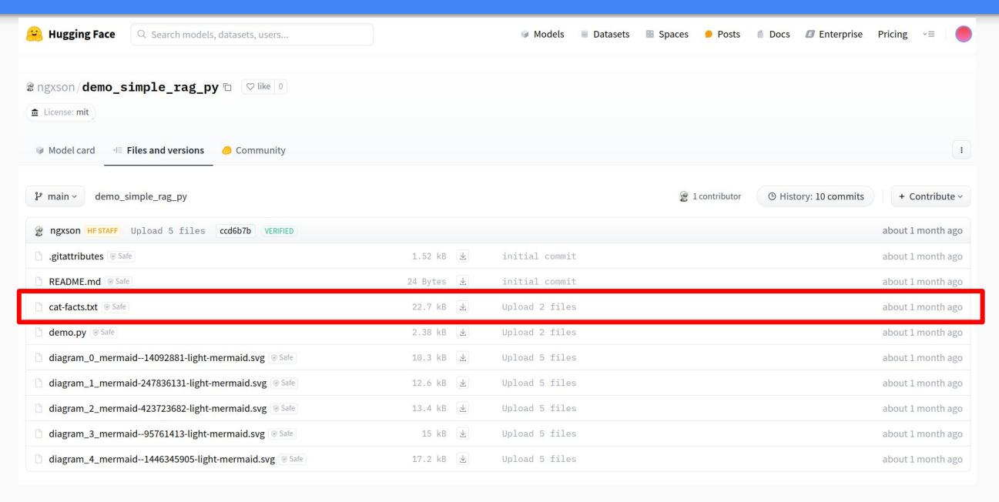
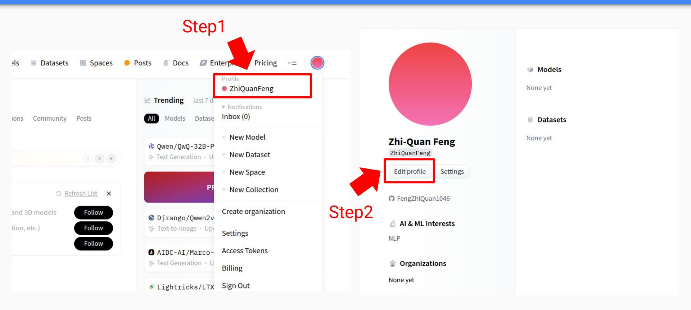
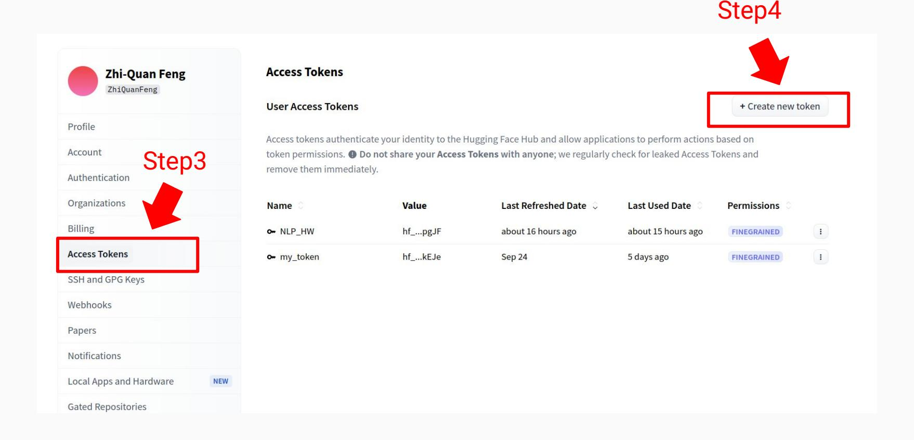
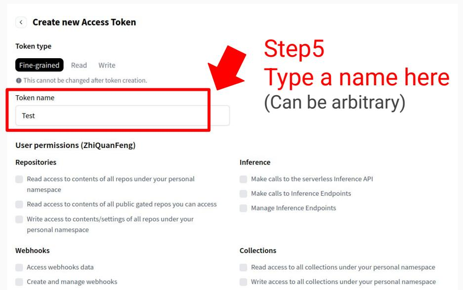
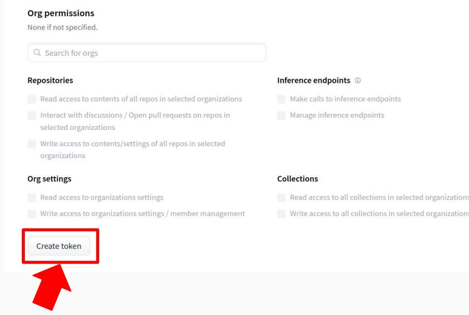
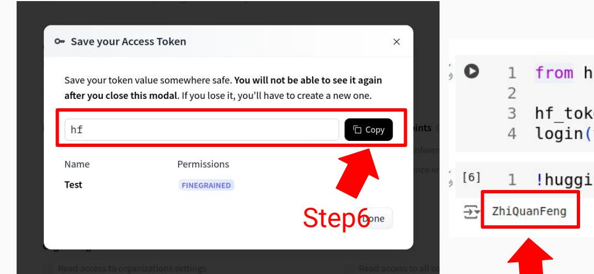
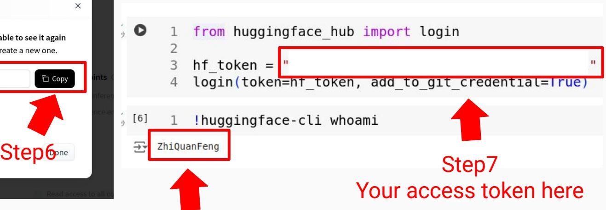
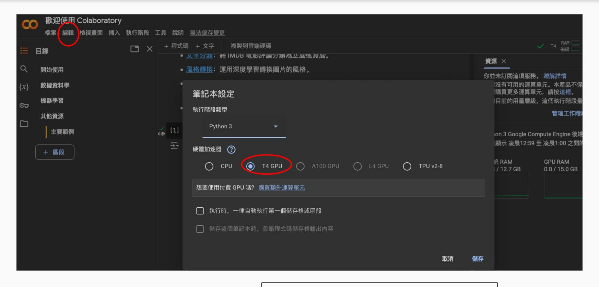
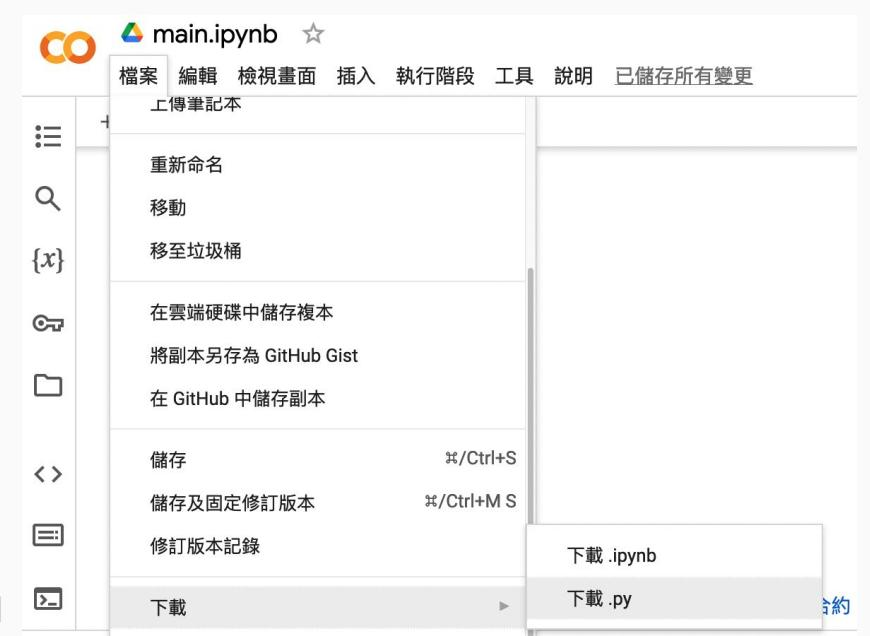

# Assignment 4: Retrieval-Augmented Generation with LangChain

2025 NTHU Natural Language Processing

Hung-Yu Kao

**IKM Lab TAs** 

## Assignment Description

- Task: Retrieval-Augmented Generation (RAG) for **Question Answering**
- Database: Cats' knowledge in texts
- Inputs: **Questions** about cats' knowledge
- Answer: Short answers for the questions (evaluation: exact matching)
- Restricted models
  - Generator: Llama-3.2-1B (freezed)

## Retrieval-Augmented Generation (RAG)

What is the technical term for a cat's hairball? **Input Query LLM Output** 1967 (Without RAG) Generator Which year was Oppenheimer born? 1904 (With RAG) (e.g., LLM) bezoar Retriever (e.g., BERT) Robert Oppenheimer (born April 22, 1904, New York, New York, U.S.—died February Retrieved 18, 1967, Princeton, New Jersey) was an **Documents** American theoretical physicist and science administrator ... **Knowledge Base** 

(e.g., Wikipedia)

Gao, Yunfan, et al. "Retrieval-augmented generation for large language models: A survey." *arXiv preprint arXiv:2312.10997* (2023).

## Dataset: Cat-facts



The dataset is presented in ngxson/demo\_simple\_rag\_py <sup>4</sup>

## Dataset

### [Cat-facts dataset](https://huggingface.co/ngxson/demo_simple_rag_py/resolve/main/cat-facts.txt)

- Database size: 150 facts
- Test QA: 150 QA pairs (generated by GPT-5)
- Each fact is represented as a sentence.
  - E.g., When a cat chases its prey, it keeps its head level. Dogs and humans bob their heads up and down.
  - E.g., The technical term for a cat's hairball is a "bezoar."

○ … <sup>5</sup>

### Construction for Questions and Answers

| Index | Question                                                    | Answer Sentence in the database                                                                                          | Answer we<br>set  |
|-------|-------------------------------------------------------------|--------------------------------------------------------------------------------------------------------------------------|-------------------|
| 1     | Why don't cats have a sweet tooth?                          | Unlike dogs, cats do not have a sweet tooth.<br>Scientists believe this is due to a mutation in a<br>key taste receptor. | Taste<br>mutation |
| 2     | How many sounds do cats make?                               | Cats make about 100 different sounds. Dogs<br>make only about 10.                                                        | About 100         |
| 3     | How many domestic cats exist<br>worldwide?                  | There are more than 500 million domestic cats<br>in the world, with approximately 40 recognized<br>breeds.               | 500 million       |
| 4     | How many people are bitten by cats<br>annually in the U.S.? | Approximately 40,000 people are bitten by<br>cats in the U.S. annually.                                                  | 40,000            |
| 5     | What is a cat's top running speed?                          | A cat can travel at a top speed of<br>approximately 31 mph (49 km) over a short<br>distance.                             | 31 mph            |

# Code (hints only)

You can modify the code template this time!

#### Connect to Huggingface (1/4)



#### Connect to Huggingface (2/4)



#### Connect to Huggingface (3/4)





Step6

#### Connect to Huggingface (4/4)





If you succeed, your Hugging Face ID will be displayed here.

#### How to use GPU on Colab?



!nvidia-smi <sup>12</sup> Type in a code block:

### TODO1: Set up the environment of Ollama (1/3)

Install the colab-xterm package and use "load\_ext" to use it.

### TODO1: Set up the environment of Ollama (2/3)

Use "%xterm" and the followint command to the command line:

- curl -fsSL https://ollama.com/install.sh | sh
- Download Llama3.2-1b using pull command in Ollama
- ollama serve

#### A simple test of Ollama

- Here we define the retrieval model and document reader model.
- We can perform a simple test for checking Ollama's status.
- The .invoke API is to input sequence to the model and obtain the outputs.

Build a simple document retriever using LangChain (HuggingFaceEmbeddings).

## TODO2: Load the cat-facts dataset and prepare the retrieval database

Load the data to be retrieved and use the langchain.docstore.document.Document API to construct a database.

## TODO2: Load the cat-facts dataset and prepare the retrieval database

### TODO3: Set up the `system\_prompt` and configure the prompt

Write a system prompt to guide the document reader model in performing the desired task.

## TODO4: Build and run the RAG system

```
retrieval_chain
            stuff_documents_chain
```

#### The Question and Answer Pairs

```
notebook file.
Load
```

The queries (the ten questions) and the correct answers are provided in the

There are 150 QA pairs, each corresponding to an entry in the Cat-Fact dataset, and they appear in the same order as in the original dataset.

#### The Question and Answer Pairs


[2]

[3]

[4]

[5]

QA pair for [1] QA pair for [2] QA pair for [3] QA pair for [4] QA pair for [5] The first QA pair corresponds to the first data, the second QA pair corresponds to the second data… **The data in cat-fact and QA pairs are in the same order.**

#### TODO4-3 and TODO5: Improve to let the LLM correctly answer the ten questions.

#### Input the query to the RAG system and get the response

```
Evaluate the response
```

Print the scores

## Submission

#### Scoring for TODOs

| TODO                                                                                                                                                                               | Score |
|------------------------------------------------------------------------------------------------------------------------------------------------------------------------------------|-------|
| TODO1: Set up the environment of Ollama                                                                                                                                            | 5%    |
| TODO2: Load the cat-facts dataset and prepare the retrieval database                                                                                                               | 10%   |
| TODO3: Set up the `system_prompt` and configure the prompt.                                                                                                                        | 10%   |
| TODO4: Build and run the RAG system<br>(Your submitted verion should use jina-embeddings-v2-base-en and Llama3.2-1b<br>model, if not, your score for TODO4 will be reduced by 50%) | 10%   |
| TODO5: Improve to let the LLM correctly answer the 150 questions.<br>(Use Llama3.2-1b)                                                                                             | 10%   |

You must upload a JSON file that includes all **test questions**, their **ground-truth answers**, and your corresponding **predictions**. The JSON file is like:

[{"Query": … , "Ground\_Truth": …, "Prediction": …}, {"Query": … , "Ground\_Truth": …, "Prediction": …}, …]

#### Scoring

#### Coding work : 45%

- You must upload a JSON file that includes all **test questions**, their **ground-truth answers**, and your corresponding **predictions**. Additionally, your report must include a screenshot showing your testing logs and the resulting accuracy.
- For retrieval please report recall@1 and recall@5 scores, for generation, please report the exact match (EM) score.
- If either of these required items is missing, your score for TODO5 will be reduced by 50%.

#### Report: 55%

- **●** (5%) Please describe the **details of your implementation for the RAG system** (please tell us 1. What's in your RAG system? 2. What's your prompt? 3. What's new in your code in comparison with the code from our lab course?) in this assignment.
- **●** (10%) Please provide analysis for the RAG performance using different prompts in **generator** model.
- (10%) Please analyze the RAG performance under different input data formats provided to the **retriever**.
- (10%) Please provide analysis for the RAG performance using different **input order** of the retrieved documents to the generator model.
- (10%) Please analyze the generation performance of the model when **counterfactual information** is introduced into the input sequence of the generator.
- (10%) Anything that can strengthen your report.

#### Delivery policies: File formats

- Coding work: Python file (.py or .ipynb)
  - Download your script via Colab.
- Predictions: Json file (.json)
- Package list: requirements.txt
  - E.g., numpy==1.26.3
- Report: Microsoft Word (.docx or .pdf)
- No other formats are allowed.
- Zip the files above before uploading you assignment.



## Delivery policies: Filenames

● Do not forget the correct formats!

|              | Filename rule                  | Filename example           |
|--------------|--------------------------------|----------------------------|
| Coding work  | NLP_HW4_school_student_ID.py   | NLP_HW4_NTHU_12345678.py   |
| Predictions  | NLP_HW4_school_student_ID.json | NLP_HW4_NTHU_12345678.json |
| Report       | NLP_HW4_school_student_ID.docx | NLP_HW4_NTHU_12345678.docx |
| Package list | requirements.txt               |                            |
| Zipped file  | NLP_HW4_school_student_ID.zip  | NLP_HW4_NTHU_12345678.zip  |

## Delivery policies: Things You should include

#### ● In your report:

|                     | Example            |                                               |  |
|---------------------|--------------------|-----------------------------------------------|--|
| Environment types   | If Colab or Kaggle | If local                                      |  |
| Running environment | Colab              | System: Ubuntu 22.04,<br>CPU: Ryzen 7-7800X3D |  |
| Python version      | Colab              | Python 3.10.1                                 |  |

## Delivery policies: Rules of coding

- If you use ChatGPT or Generative AI, please specify your usage **both** in:
  - **○ Code comments**
  - **○ Reports**
- **No plagiarism**. You should not copy and paste from your classmates. **Submit duplicate code or report will get 0 point !**
- Please provide links if you take the code from the Internet as reference.
- The following behaviors will cause loss in the score of the assignment: **(1) Usage with Generative AI without specifications (2) Internet sources without specifications (3) Plagiarism.**

## Punishments

| Rule       | Name your code:<br>NLP_HW3_school_st<br>udent_ID.py (.ipynb<br>is also acceptable) | Name your report:<br>NLP_HW3_school_stu<br>dent_ID.docx (.pdf is<br>also acceptable) | Name your file:<br>NLP_HW3_school_stu<br>dent_ID.zip                                                          | Include<br>requirements.txt |
|------------|------------------------------------------------------------------------------------|--------------------------------------------------------------------------------------|---------------------------------------------------------------------------------------------------------------|-----------------------------|
| Punishment | -5                                                                                 | -5                                                                                   | -5                                                                                                            | -5                          |
| Rule       | Include python<br>version in your report                                           | Do not modify the<br>report template                                                 | Your code or report<br>should not shows a<br>high degree of<br>similarity to another<br>student's submission. |                             |
| Punishment | -5                                                                                 | -5                                                                                   | -100 for both                                                                                                 |                             |

In this assignment, you are allowed to modify the code template!

## Uploading the zipped file

- Please upload your file to NTU COOL.
- You will have three weeks to finish this assignment.
- If you have any question, please e-mail to **nthuikmlab@gmail.com**